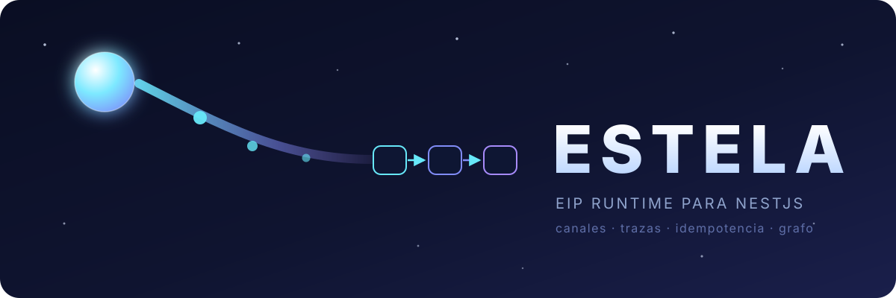
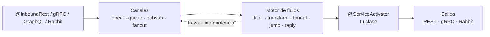

<div align="center">
  

  **Enterprise Integration Patterns para NestJS, con la semántica de Spring Integration y nativo de Node.**<br/>
  *El flujo le habla a canales, no a clases.*

  [](https://github.com/dyddtechnologies/estela-rt/releases/latest)
  [](https://github.com/dyddtechnologies/estela-rt/releases)
  [](#-requisitos)
  [](#-requisitos)
  [](#-puntos-de-entrada)
  [](./LICENSE)
  [](https://www.dyddtech.com)

  [English](./README.md) · **Español**

  [Instalar](#-instalar) · [Inicio rápido](#-inicio-rápido-5-minutos) · [Qué trae](#-qué-trae) · [Canales](#-canales) · [DSL de flujos](#-dsl-de-flujos) · [Observabilidad](#-observabilidad) · [Pruebas](#-pruebas) · [Actualizar](#-actualizar) · [Preguntas](#-preguntas-frecuentes)
</div>

---

> **Estela**: la que deja un cometa al pasar. Cada mensaje que pasa por el runtime deja un rastro: un `traceId`,
> un `spanId` y un `history` de saltos. Cada salto es un punto de esa estela.

## ✨ Qué trae

| | |
|---|---|
| 📨 **4 tipos de canal con semántica EIP real** | `direct` · `queue` · `pubsub` · `fanout`, en memoria. Los brokers se conectan como puertos. |
| 🧩 **DSL de flujos fluido** | `filter → transform → wireTap → fanoutTo → jumpTo → publish → route → to → reply` |
| 🔁 **Request/reply** | Canales de respuesta efímeros y timeouts sin carreras. |
| 🛰 **Adaptadores de entrada** | REST · gRPC · RabbitMQ · GraphQL, **declarados en tus controllers**. |
| 🔭 **Trazas** | `x-trace-id`, `x-correlation-id`, `x-causation-id`; el contexto se reconstruye de los headers en cada salto. |
| 🛡 **Idempotencia** | Scopes `flow:*` / `activator:*` con store intercambiable (memoria o Redis). |
| 🧾 **Sagas** | Unidades de trabajo, compensación, locks, reintentos, `afterCommit` y máquinas de estado con `transition()`. |
| 🔒 **Privacidad** | Marca los datos privados para que logs, stores y ledgers nunca los guarden. |
| 🗺 **Topología en vivo** | `GET /integration/graph` (JSON) y `/integration/graph/mermaid`. |
| 🪶 **Sin dependencias de runtime para la mensajería** | Los adaptadores son peers opcionales que instalas solo si los usas. |



## 🚀 Instalar

ESTELA se distribuye como **asset de una GitHub Release**, así que no necesitas un registro npm ni un token. Fija una versión exacta:

```bash
npm install https://github.com/dyddtechnologies/estela-rt/releases/download/v0.14.3/estela-nest-0.14.3.tgz
```

<details>
<summary><b>Instalar siempre la versión más nueva</b></summary>

```bash
V=$(curl -fsSL https://api.github.com/repos/dyddtechnologies/estela-rt/releases/latest | sed -n 's/.*"tag_name": *"v\([^"]*\)".*/\1/p')
npm install "https://github.com/dyddtechnologies/estela-rt/releases/download/v${V}/estela-nest-${V}.tgz"
```

Funciona igual con `pnpm add` y `yarn add`. La URL queda en tu `package.json`, así que los builds son reproducibles.
</details>

### 📋 Requisitos

| Paquete | Versión | |
|---|---|---|
| Node.js | **18+** | |
| `@nestjs/common`, `@nestjs/core` | 10 · 11 (ver nota) | peer |
| `@nestjs/swagger` | 7 u 8 | peer |
| `reflect-metadata` | ≥ 0.1.13 | peer |
| `rxjs` | 7 | peer |
| `amqplib` · `@grpc/grpc-js` · `@nestjs/graphql` | — | **opcionales**, solo para los adaptadores RabbitMQ / gRPC / GraphQL |

> **Notas de compatibilidad de v0.14.3** (verificadas compilando el inicio rápido de abajo):
> - ✅ **NestJS 10** con `@nestjs/swagger` 7/8 instala limpio.
> - ⚠️ **NestJS 11** usa `@nestjs/swagger` 11, pero el rango de peers de ESTELA sigue en `^7 || ^8`. Hasta que una versión lo amplíe, instala con `npm install --legacy-peer-deps`.
> - ⚠️ **`@estela/nest/testing`** es un subpath export: TypeScript lo resuelve con `"moduleResolution": "node16"`, `"nodenext"` o `"bundler"`. El `"node"` por defecto de Nest solo ve la entrada principal.

### 📦 Puntos de entrada

| Import | Qué |
|---|---|
| `@estela/nest` | El runtime: `IntegrationModule`, `IntegrationFlow`, decoradores, sagas… |
| `@estela/nest/testing` | Ayudas para pruebas: `bindFlow`, `waitFor`, `createTestMessage`, `captureTrail`, `expectNoLeak`… |

Trae ESM, CommonJS y declaraciones de tipos.

## ⚡ Inicio rápido (5 minutos)

**1 · Declara los canales y registra tus flujos**

```ts
import { Module } from '@nestjs/common';
import { IntegrationModule } from '@estela/nest';

@Module({
  imports: [
    IntegrationModule.forRoot(
      {
        channels: [
          { name: 'orders.place', type: 'direct' },
          { name: 'orders.audit', type: 'queue', capacity: 10_000 },
          { name: 'domain.events', type: 'pubsub' },
        ],
        idempotency: { enabled: true },
      },
      [PlaceOrderFlow],
    ),
  ],
  providers: [InventoryActivator],
  controllers: [OrdersController],
})
export class AppModule {}
```

**2 · Describe el flujo. Solo conoce nombres de canales.**

```ts
import { FlowDefinition, IntegrationFlow } from '@estela/nest';

export const PlaceOrderFlow: FlowDefinition = {
  name: 'place-order',
  build: () =>
    IntegrationFlow.from('orders.place')
      .filter((p) => (p as { qty: number }).qty > 0)
      .wireTap('orders.audit')                                      // copia sin esperar
      .jumpTo([{ channel: 'inventory.reserve', timeoutMs: 3_000 }]) // espera una respuesta
      .publish('domain.events', 'order.placed')
      .reply(),                                                     // responde al cliente HTTP
};
```

**3 · Conecta tu clase a un canal**

```ts
import { Injectable } from '@nestjs/common';
import { ServiceActivator } from '@estela/nest';

@Injectable()
export class InventoryActivator {
  @ServiceActivator('inventory.reserve')
  reserve(payload: unknown): string {
    return 'reserved'; // lo que retorna responde al canal de respuesta del salto
  }
}
```

**4 · Expónlo**

```ts
import { Body, Controller, Post } from '@nestjs/common';
import { InboundRest } from '@estela/nest';

@Controller('orders')
export class OrdersController {
  @Post()
  @InboundRest({ channel: 'orders.place', requestReply: true, timeoutMs: 5_000 })
  place(@Body() dto: PlaceOrderDto): void {} // → { status: 'ok', result, headers }
}
```

**5 · Míralo**

```bash
curl localhost:3000/integration/graph/mermaid
```

## 📨 Canales

| Tipo | Semántica |
|---|---|
| `direct` | Un suscriptor; `send` espera al handler. Sin suscriptor **lanza error**. |
| `queue` | Buffer FIFO con round-robin y capacidad. El desborde es un **error, nunca una pérdida silenciosa**. |
| `pubsub` | Broadcast con routing keys `*` / `#`, grupos round-robin y aislamiento de fallas por suscriptor. |
| `fanout` | Copia a bindings y suscriptores, esperando o no, con **guarda de ciclos** A↔B. |

## 🧩 DSL de flujos

| Paso | Semántica |
|---|---|
| `filter` | Termina el flujo con éxito cuando el predicado falla. `whenDropped.reply` responde al cliente al instante. |
| `transform` / `handle` | Reemplazan el payload; `handle` nunca dispara una respuesta. |
| `headers(values \| fn)` | Mezcla headers (tenant, remitente…) en el mensaje. |
| `wireTap` | Copia sin esperar que nunca responde al cliente y se traga los errores. |
| `fanoutTo` | Grupo en paralelo; con `wait: false` las fallas van a `error.channel`. |
| `jumpTo` / `jump` | Espera una respuesta con timeout y la guarda en `jumpReplies[channel]`. |
| `publish` | Publica con routing key; el pipeline sigue. |
| `route` / `to` | Envía a un canal dinámico, o a uno fijo, y **termina** el flujo. |
| `reply` | Responde al cliente de entrada con `'current'` o `'jumpMerge'`. |

## 🔭 Observabilidad

```bash
curl localhost:3000/integration/graph          # nodos · aristas · flujos (JSON)
curl localhost:3000/integration/graph/mermaid  # topología en Mermaid
```

- **Log de arranque:** lista cada activator, entrada y salida.
- **Headers que viajan en cada salto:**
  - `x-trace-id` / `x-span-id` / `x-parent-span-id`;
  - `x-correlation-id` / `x-causation-id`;
  - `idempotency-key`.

## 🧪 Pruebas

```ts
import { bindFlow, waitFor, MemoryIdempotencyStore, captureTrail, expectNoLeak } from '@estela/nest/testing';

bindFlow(PlaceOrderFlow, registry);
await registry.send('orders.place', { qty: 2, sku: 'A' });
const reply = await waitFor(registry, 'reply.http-1', 2_000);
```

`captureTrail()` + `expectNoLeak()` prueban que un secreto (una tarjeta, un token) nunca llega a un log, un store o un ledger.

## 🔄 Actualizar

1. **Instala la URL de la versión nueva** (ver [Releases](https://github.com/dyddtechnologies/estela-rt/releases); cada una lista sus cambios).
2. **Lee las notas** buscando **BREAKING** o **behaviour change**.
3. **Corre tus pruebas.**
4. **Compara el log de arranque** y `/integration/graph` con la versión anterior: deben aparecer los mismos activators, entradas y salidas.

## ❓ Preguntas frecuentes

<details><summary><b>¿Necesito un broker de mensajes?</b></summary>

No. Los canales viven en memoria. RabbitMQ, gRPC y GraphQL son adaptadores opcionales para hablar con el exterior.
</details>

<details><summary><b>¿Por qué no está en npm?</b></summary>

Las GitHub Releases dan tarballs exactos e inmutables sin cuenta ni token de registro. Instala por URL y fíjala.
</details>

<details><summary><b>¿Lo puedo usar en un producto comercial?</b></summary>

Sí. Tiene licencia MIT: es gratis para usar, modificar y distribuir, también comercialmente.
</details>

<details><summary><b>¿Dónde está la referencia completa?</b></summary>

En el [repositorio de ESTELA](https://github.com/dyddtechnologies/estela#readme): privacidad, sagas, políticas de cuidado, entrada gRPC de comandos, salida request/reply y más.
</details>

## 💬 Soporte

Preguntas o errores: [abre un issue](https://github.com/dyddtechnologies/estela-rt/issues). Incluye:

- las versiones de ESTELA, Node y NestJS;
- una reproducción mínima.

## 📜 Licencia

**ESTELA es una contribución de D&DD Tech a la comunidad open source.** Es gratis, también en productos comerciales, bajo la [Licencia MIT](./LICENSE). Este repositorio distribuye el runtime empaquetado y cómo usarlo.

---

<div align="center">
  <sub><b>ESTELA</b> — hecho con ☄️ por <a href="https://www.dyddtech.com"><b>D&DD Tech</b></a> · Copyright © 2026 D&DD Inversiones</sub>
</div>
