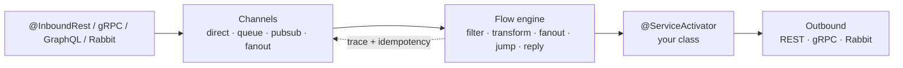

<div align="center">
  

  **Enterprise Integration Patterns for NestJS, with Spring Integration semantics and native to Node.**<br/>
  *The flow talks to channels, not to classes.*

  [](https://github.com/dyddtechnologies/estela-rt/releases/latest)
  [](https://github.com/dyddtechnologies/estela-rt/releases)
  [](#-requirements)
  [](#-requirements)
  [](#-entry-points)
  [](./LICENSE)
  [](https://www.dyddtech.com)

  **English** · [Español](./README.es.md)

  [Install](#-install) · [Quick start](#-quick-start-5-minutes) · [What you get](#-what-you-get) · [Channels](#-channels) · [Flow DSL](#-flow-dsl) · [Observability](#-observability) · [Testing](#-testing) · [Upgrade](#-upgrading) · [FAQ](#-faq)
</div>

---

> **Estela** *(Spanish for "trail", the wake a comet leaves behind)*. Every message that travels through the runtime leaves a
> trail: a `traceId`, a `spanId` and a `history` of hops. Every hop is a point on that trail.

## ✨ What you get

| | |
|---|---|
| 📨 **4 channel types with real EIP semantics** | `direct` · `queue` · `pubsub` · `fanout`, all in memory. Brokers plug in as ports. |
| 🧩 **A fluent flow DSL** | `filter → transform → wireTap → fanoutTo → jumpTo → publish → route → to → reply` |
| 🔁 **Request/reply** | Ephemeral reply channels and race-free timeouts. |
| 🛰 **Inbound adapters** | REST · gRPC · RabbitMQ · GraphQL, **declared on your controllers**. |
| 🔭 **Tracing** | `x-trace-id`, `x-correlation-id`, `x-causation-id`; the context is rebuilt from headers at every hop. |
| 🛡 **Idempotency** | `flow:*` / `activator:*` scopes with a swappable store (memory or Redis). |
| 🧾 **Sagas** | Units of work, compensation, locks, retry, `afterCommit` and state machines with `transition()`. |
| 🔒 **Privacy** | Marks private data so logs, stores and ledgers never keep it. |
| 🗺 **Live topology** | `GET /integration/graph` (JSON) and `/integration/graph/mermaid`. |
| 🪶 **No runtime dependencies for messaging** | Adapters are optional peers that you install only if you use them. |



## 🚀 Install

ESTELA is distributed as a **GitHub Release asset**, so you don't need an npm registry or a token. Pin an exact version:

```bash
npm install https://github.com/dyddtechnologies/estela-rt/releases/download/v0.14.3/estela-nest-0.14.3.tgz
```

<details>
<summary><b>Always install the newest release</b></summary>

```bash
V=$(curl -fsSL https://api.github.com/repos/dyddtechnologies/estela-rt/releases/latest | sed -n 's/.*"tag_name": *"v\([^"]*\)".*/\1/p')
npm install "https://github.com/dyddtechnologies/estela-rt/releases/download/v${V}/estela-nest-${V}.tgz"
```

Works the same with `pnpm add` and `yarn add`. The URL stays in your `package.json`, so builds are reproducible.
</details>

### 📋 Requirements

| Package | Version | |
|---|---|---|
| Node.js | **18+** | |
| `@nestjs/common`, `@nestjs/core` | 10 · 11 (see note) | peer |
| `@nestjs/swagger` | 7 or 8 | peer |
| `reflect-metadata` | ≥ 0.1.13 | peer |
| `rxjs` | 7 | peer |
| `amqplib` · `@grpc/grpc-js` · `@nestjs/graphql` | — | **optional**, only for the RabbitMQ / gRPC / GraphQL adapters |

> **Compatibility notes for v0.14.3** (checked by compiling the quick start below):
> - ✅ **NestJS 10** with `@nestjs/swagger` 7/8 installs cleanly.
> - ⚠️ **NestJS 11** uses `@nestjs/swagger` 11, but ESTELA's peer range is still `^7 || ^8`. Until a release widens it, install with `npm install --legacy-peer-deps`.
> - ⚠️ **`@estela/nest/testing`** is a subpath export: TypeScript resolves it with `"moduleResolution": "node16"`, `"nodenext"` or `"bundler"`. Nest's default `"node"` only sees the main entry.

### 📦 Entry points

| Import | What |
|---|---|
| `@estela/nest` | The runtime: `IntegrationModule`, `IntegrationFlow`, decorators, sagas… |
| `@estela/nest/testing` | Test helpers: `bindFlow`, `waitFor`, `createTestMessage`, `captureTrail`, `expectNoLeak`… |

It ships ESM, CommonJS and type declarations.

## ⚡ Quick start (5 minutes)

**1 · Declare channels and register your flows**

```ts
import { Module } from '@nestjs/common';
import { IntegrationModule } from '@estela/nest';

@Module({
  imports: [
    IntegrationModule.forRoot(
      {
        channels: [
          { name: 'orders.place', type: 'direct' },
          { name: 'orders.audit', type: 'queue', capacity: 10_000 },
          { name: 'domain.events', type: 'pubsub' },
        ],
        idempotency: { enabled: true },
      },
      [PlaceOrderFlow],
    ),
  ],
  providers: [InventoryActivator],
  controllers: [OrdersController],
})
export class AppModule {}
```

**2 · Describe the flow. It only knows channel names.**

```ts
import { FlowDefinition, IntegrationFlow } from '@estela/nest';

export const PlaceOrderFlow: FlowDefinition = {
  name: 'place-order',
  build: () =>
    IntegrationFlow.from('orders.place')
      .filter((p) => (p as { qty: number }).qty > 0)
      .wireTap('orders.audit')                                      // fire-and-forget copy
      .jumpTo([{ channel: 'inventory.reserve', timeoutMs: 3_000 }]) // await a reply
      .publish('domain.events', 'order.placed')
      .reply(),                                                     // answers the HTTP caller
};
```

**3 · Plug your class into a channel**

```ts
import { Injectable } from '@nestjs/common';
import { ServiceActivator } from '@estela/nest';

@Injectable()
export class InventoryActivator {
  @ServiceActivator('inventory.reserve')
  reserve(payload: unknown): string {
    return 'reserved'; // the return value answers the hop's reply channel
  }
}
```

**4 · Expose it**

```ts
import { Body, Controller, Post } from '@nestjs/common';
import { InboundRest } from '@estela/nest';

@Controller('orders')
export class OrdersController {
  @Post()
  @InboundRest({ channel: 'orders.place', requestReply: true, timeoutMs: 5_000 })
  place(@Body() dto: PlaceOrderDto): void {} // → { status: 'ok', result, headers }
}
```

**5 · Look at it**

```bash
curl localhost:3000/integration/graph/mermaid
```

## 📨 Channels

| Kind | Semantics |
|---|---|
| `direct` | One subscriber; `send` awaits the handler. With no subscriber it **throws**. |
| `queue` | FIFO buffer with round-robin and a capacity. Overflow is an **error, never a silent drop**. |
| `pubsub` | Broadcast with `*` / `#` routing keys, round-robin groups and per-subscriber fault isolation. |
| `fanout` | Copies to bindings and subscribers, awaited or fire-and-forget, with an A↔B **cycle guard**. |

## 🧩 Flow DSL

| Step | Semantics |
|---|---|
| `filter` | Ends the flow successfully when the predicate fails. `whenDropped.reply` answers the caller right away. |
| `transform` / `handle` | Replace the payload; `handle` never triggers a reply. |
| `headers(values \| fn)` | Merges headers (tenant, sender…) into the message. |
| `wireTap` | Fire-and-forget copy that never answers the caller and swallows errors. |
| `fanoutTo` | Parallel group; `wait: false` sends failures to `error.channel`. |
| `jumpTo` / `jump` | Awaits a reply with a timeout and collects it in `jumpReplies[channel]`. |
| `publish` | Publishes with a routing key; the pipeline keeps going. |
| `route` / `to` | Sends to a dynamic channel, or to a fixed one, and **ends** the flow. |
| `reply` | Answers the inbound caller with `'current'` or `'jumpMerge'`. |

## 🔭 Observability

```bash
curl localhost:3000/integration/graph          # nodes · edges · flows (JSON)
curl localhost:3000/integration/graph/mermaid  # topology as Mermaid
```

- **Boot log:** lists every activator, inbound and outbound.
- **Headers carried on every hop:**
  - `x-trace-id` / `x-span-id` / `x-parent-span-id`;
  - `x-correlation-id` / `x-causation-id`;
  - `idempotency-key`.

## 🧪 Testing

```ts
import { bindFlow, waitFor, MemoryIdempotencyStore, captureTrail, expectNoLeak } from '@estela/nest/testing';

bindFlow(PlaceOrderFlow, registry);
await registry.send('orders.place', { qty: 2, sku: 'A' });
const reply = await waitFor(registry, 'reply.http-1', 2_000);
```

`captureTrail()` + `expectNoLeak()` prove that a secret (a card number, a token) never reaches a log, a store or a ledger.

## 🔄 Upgrading

1. **Install the new version's URL** (see [Releases](https://github.com/dyddtechnologies/estela-rt/releases); each one lists its changes).
2. **Read the notes** for anything marked **BREAKING** or **behaviour change**.
3. **Run your test suite.**
4. **Compare the boot log** and `/integration/graph` with the previous version: you should see the same activators, inbound and outbound endpoints.

## ❓ FAQ

<details><summary><b>Do I need a message broker?</b></summary>

No. Channels are in memory. RabbitMQ, gRPC and GraphQL are optional adapters for talking to the outside world.
</details>

<details><summary><b>Why isn't it on npm?</b></summary>

GitHub Releases give you exact, immutable tarballs without a registry account or token. Install by URL and pin it.
</details>

<details><summary><b>Can I use it in a commercial product?</b></summary>

Yes. It is MIT-licensed: free to use, modify and ship, including commercially.
</details>

<details><summary><b>Where is the full reference?</b></summary>

The package ships its type declarations, so your editor documents every option of `forRoot`, the flow DSL, adapters, sagas, privacy and care policies. Each [release](https://github.com/dyddtechnologies/estela-rt/releases) lists what changed. For anything else, [open an issue](https://github.com/dyddtechnologies/estela-rt/issues).
</details>

## 💬 Support

Questions or bugs: [open an issue](https://github.com/dyddtechnologies/estela-rt/issues). Include:

- the ESTELA, Node and NestJS versions;
- a minimal reproduction.

## 📜 License

**ESTELA is a contribution of D&DD Tech to the open-source community.** It is free to use, including in commercial products, under the [MIT License](./LICENSE). This repository distributes the packaged runtime and how to use it.

---

<div align="center">
  <sub><b>ESTELA</b> — built with ☄️ by <a href="https://www.dyddtech.com"><b>D&DD Tech</b></a> · Copyright © 2026 D&DD Inversiones</sub>
</div>
